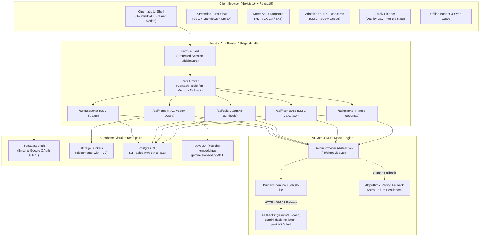

# 🌌 Nova — Cinematic AI Learning Companion

[](https://nova-himanshu-rawat.vercel.app)
[](https://github.com/rawat-code/nova-ai)
[](https://nextjs.org/)

> 🌐 **Live Production App:** [https://nova-himanshu-rawat.vercel.app](https://nova-himanshu-rawat.vercel.app)  
> 🔗 **Alternative Mirror:** [https://nova-nine-liard.vercel.app](https://nova-nine-liard.vercel.app)

Nova is an adaptive AI learning companion designed for high school and undergraduate students. It analyzes how students study, detects conceptual weak spots, and personalizes tutoring, notes retrieval, quiz synthesis, spaced repetition, and exam roadmaps.

---

## 🏛️ System Architecture



---

## ⚡ Key Features

1. **Adaptive AI Tutor**:
   - Streaming SSE chat with 4 distinct cognitive modes: *Explain Simply*, *Deep Dive*, *Socratic Dialogue*, and *Exam Simulation*.
   - Dynamic math rendering via KaTeX and formatted syntax-highlighted code blocks.
2. **Notes Vault & Citation-Grounded RAG**:
   - PDF, DOCX, TXT parsing and chunking with semantic overlap.
   - 768-dimensional vector embeddings with cosine similarity matching (`match_chunks`).
   - Prompt-injection boundary hygiene: uploaded text is treated as untrusted data, never as prompt instructions.
3. **Adaptive Quiz Engine**:
   - Synthesizes MCQs, short answers, and true/false questions calibrated to student difficulty level.
   - Immediate feedback, score calculation, and mastery tracking.
4. **Flashcards with Spaced Repetition (SM-2)**:
   - SuperMemo SM-2 interval scheduling algorithm (`interval_days`, `ease_factor`, `repetition`).
   - Daily review queue and instant deck generation from vault notes.
5. **Exam Study Planner**:
   - Calculates daily study blocks from exam deadlines and available weekly hours.
   - Built-in multi-model failover and algorithmic pacing engine so students are never blocked by API rate limits.
6. **Focus Sanctuary**:
   - Pomodoro timer with animated ambient scene and automated session logging.
7. **Learning DNA**:
   - Tracks mastery per topic, struggling subjects, and optimal focus windows. Injects personalized cognitive context into tutor prompts.

---

## 🛠️ Local Development & Setup

### Prerequisites
- **Node.js**: `v20.x` or `v22.x`
- **npm**: `v10+` or `v12+`

### 1. Clone & Install Dependencies
```bash
git clone https://github.com/your-username/nova.git
cd nova
npm install
```

### 2. Environment Configuration
Copy the template configuration:
```bash
cp .env.example .env.local
```
Fill in your credentials in `.env.local` (see Environment Variables table below).

### 3. Verify Environment Integrity
Nova includes a strict environment integrity validator that checks all client-safe and server-only variables:
```bash
npm run check-env
```

### 4. Start Development Server
```bash
npm run dev
```
Open [http://localhost:3000](http://localhost:3000) to view the application.

---

## 🔐 Environment Variables Guide

| Variable | Scope | Requirement | Description |
|---|---|---|---|
| `NEXT_PUBLIC_SITE_URL` | Client | **Required** | Application base URL (`http://localhost:3000` in dev, production URL in prod) |
| `NEXT_PUBLIC_SUPABASE_URL` | Client | **Required** | Supabase project URL (`https://xyz.supabase.co`) |
| `NEXT_PUBLIC_SUPABASE_ANON_KEY` | Client | **Required** | Supabase anonymous public API key |
| `NEXT_PUBLIC_SPLINE_SCENE_URL` | Client | Optional | Public URL for 3D Spline scene (falls back to React Bits Aurora) |
| `SUPABASE_SERVICE_ROLE_KEY` | Server-only | **Required** | Admin secret key for service-role database operations |
| `GEMINI_API_KEY` | Server-only | **Required** | Google AI Studio Gemini API Key |
| `GEMINI_CHAT_MODEL` | Server-only | Optional | Primary chat model (`gemini-3.5-flash-lite`, defaults with automatic fallback) |
| `GEMINI_EMBEDDING_MODEL` | Server-only | Optional | Embedding model (`gemini-embedding-001`, 768 dimensions) |
| `UPSTASH_REDIS_REST_URL` | Server-only | Optional | Upstash Redis URL for distributed rate limiting |
| `UPSTASH_REDIS_REST_TOKEN` | Server-only | Optional | Upstash Redis REST Token |

> 🚨 **Security Notice**: All server-only environment variables are protected by a runtime Proxy guard in `lib/env.ts` that immediately throws an exception if any attempt is made to bundle or access them on the client side.

---

## 🧪 Testing

Nova maintains dual test suites for both unit logic and end-to-end browser flows:

### Run Logic & Security Unit Tests (Vitest)
Executes all 13 test suites covering SM-2 algorithm, chunking, RLS isolation policies, PDF parsing, prompt builders, learning DNA, and rate limiting:
```bash
npm test
```

### Run End-to-End Critical Flows (Playwright)
Validates the 3 critical user journeys:
1. Signup, login, and onboarding navigation (`e2e/auth-flow.spec.ts`)
2. Notes Vault dropzone, empty states, and citation-grounded Q&A (`e2e/vault-qa-flow.spec.ts`)
3. Quiz synthesis, difficulty calibration, and flashcard review queues (`e2e/quiz-flashcards-flow.spec.ts`)
```bash
npx playwright test
```

---

## 🚀 Deployment Guide (Vercel + Supabase)

### 1. Supabase Setup
1. Create a new Supabase project at [supabase.com](https://supabase.com).
2. Enable `pgvector` extension under **Database** ➔ **Extensions**.
3. Run migrations in order from `supabase/migrations/`:
   - `0000_extensions.sql` (pgvector, pgcrypto)
   - `0001_core_schema.sql` (profiles, documents, chunks, conversations, messages)
   - `0002_study_features.sql` (quizzes, quiz_attempts, flashcards, study_plans, sessions, insights)
   - `0003_rls_policies.sql` (strict Row Level Security policies on every table)
4. Create a private storage bucket named `documents` and configure owner-isolated RLS.
5. In **Authentication** ➔ **URL Configuration**:
   - Set **Site URL** to your production URL (`https://your-domain.vercel.app`).
   - Add redirect URL: `https://your-domain.vercel.app/**`.

### 2. Vercel Deployment
1. Import your Git repository into [Vercel](https://vercel.com).
2. Configure Project Settings:
   - **Framework Preset**: Next.js
   - **Build Command**: `npm run build`
   - **Output Directory**: `.next`
3. Add Environment Variables:
   - `NEXT_PUBLIC_SITE_URL`: `https://your-domain.vercel.app`
   - `NEXT_PUBLIC_SUPABASE_URL`: `https://<project-ref>.supabase.co`
   - `NEXT_PUBLIC_SUPABASE_ANON_KEY`: `<anon-key>`
   - `SUPABASE_SERVICE_ROLE_KEY`: `<service-role-secret>`
   - `GEMINI_API_KEY`: `<google-ai-studio-key>`
   - `GEMINI_CHAT_MODEL`: `gemini-3.5-flash-lite`
   - `GEMINI_EMBEDDING_MODEL`: `gemini-embedding-001`
   - *(Optional)* `UPSTASH_REDIS_REST_URL` & `UPSTASH_REDIS_REST_TOKEN`
4. Click **Deploy**. Vercel will build the production bundle and verify environment contracts.

### 3. Active Live Deployment
- **Production URL**: [https://nova-himanshu-rawat.vercel.app](https://nova-himanshu-rawat.vercel.app)
- **Alternative Mirror**: [https://nova-nine-liard.vercel.app](https://nova-nine-liard.vercel.app)
- **Status**: Live and Operational (Continuous Deployment enabled via `main` branch pushes)

---

## 📄 License
MIT License. Built for students seeking mastery through deliberate practice and cognitive pacing.
